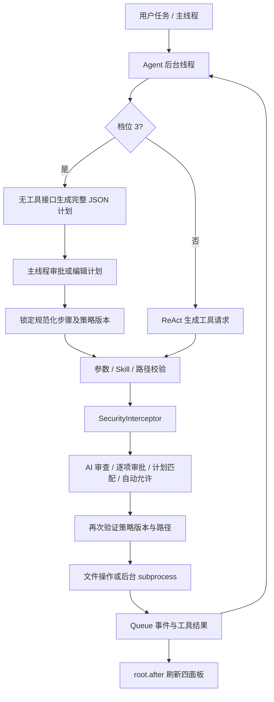

# ClawX · 本地 AI Agent 工作台

基于 Python 标准库和 tkinter/ttk 的桌面应用，支持对话、文件变更、交付报告、四档安全策略、指定目录边界、Skill 管理和真实模型工具调用。主界面隐藏终端面板及其侧栏入口，后台仍执行命令并保留输出记录。

## v1.7.0 · 快速唤醒与分支对话

新增 Windows 全局快速唤醒（默认双击 Alt）、极简输入浮窗、模型列表右键管理，以及可选择消息起点的分支对话。

主模式只有 **聊天** 和 **开发**，也可以按 `Ctrl+M` 切换。选择聊天后，显示 **即时回答 / 深入讨论** 两个子选项。

- **即时回答**：提供 **标准 / 中 / 高** 三档思考等级（对应 Low / Medium / High），简洁直接；保留用户此前选择的五档等级，切回深入讨论后恢复。
- **深入讨论**：启用思考二级菜单中的五档滑块，用于梳理假设、比较方案、分析细节，与即时回答共享聊天上下文。
- **开发**：保留四面板、Skill、文件工具、受控终端与四档审批，使用同一思考二级菜单。

两种聊天方式都不附带工具定义；异常工具响应直接拒绝；调度器、工具入口与安全拦截器都有硬限制，不执行 Agent 文件或命令操作。应用仍会保存用户偏好，用户主动导出仍可写文件。范围和安全档位控件仅在开发模式显示，切换聊天时保留原设置。

两种模式各保留最近四轮上下文。切换时恢复对应对话，工作报告不会自动注入聊天请求；「新建任务」清空当前模式的会话，保留另一模式和实际文件。发送时复制配置，执行期间锁定模式和思考等级；停止或完成后解锁。安全档位与范围仍可实时调整。

### 思考等级如何生效

输入框工具栏只显示「思考 · 当前等级 ▾」入口，点击展开二级菜单，再次点击或点击「收起」关闭。菜单顶部是 **模型下拉框**（列出模型列表中的全部模型，选中立即切换），下方是吸附滑块：开发与深入讨论显示模型支持的 **Low / Medium / High / Max / Ultra** 档位，即时回答显示 **标准 / 中 / 高** 三档；模型不支持的档位会变暗且无法选中。支持点击滑轨、拖动滑块；拖动中预览，松开后提交等级。聚焦后可用方向键逐档调整、Home / End 跳到两端，Esc 取消当前拖动。`Ctrl+U` 在当前等级与最高档之间切换（即时回答内为 高 ↔ 中）。它们是 ClawX 的应用策略，不能保证每个服务商都有同名档位，也不表示已消耗的推理量。

| 等级 | 通用策略 | 开发模式最多调度轮数 | 原生 OpenAI 请求值（受上限约束） | Claude 手动预算 |
| --- | --- | --- | --- | --- |
| Low | 快速回答与必要验证 | 8 | low | 1,024 |
| Medium | 均衡分析与边界检查 | 16 | medium | 2,048 |
| High | 深入分析设计与失败路径 | 20 | high | 4,096 |
| Max | 全面比较方案与回归风险 | 24 | xhigh | 8,192 |
| Ultra | 深度检查假设、并发与安全 | 32 | max | 16,384 |

聊天每条消息只请求一次模型，不运行工具循环。计划模式仍最多 40 个批准步骤，不因等级提高扩大权限。

在「模型与连接」中选择思考接口：

- `portable`（默认）：只使用五档提示词策略和工作调度轮数，兼容普通模型及第三方网关；不发送原生 reasoning 参数，也不声称开启了模型原生推理预算。
- `openai`：发送 `reasoning_effort` 和 `max_completion_tokens`。默认 effort 上限为 `high`；仅在模型支持时改为 `xhigh` 或 `max`。Max / Ultra 在上限较低时会被限制，应用指令与轮数仍不同。字段及模型差异见 [OpenAI 官方文档](https://developers.openai.com/api/reference/resources/chat/subresources/completions/methods/create)。
- `anthropic`：显式启用 `thinking.type=adaptive` 与 `output_config.effort`；Max 对应 high，Ultra 请求 max，均受 effort 上限约束。须使用支持这些字段和值的模型。
- `anthropic_manual`：面向支持旧版手动扩展思考的 Claude 模型，发送表中 `budget_tokens`；输出上限为预算加 4,096。新版模型可能不支持该接口；见 [Claude 官方扩展思考文档](https://platform.claude.com/docs/en/build-with-claude/extended-thinking)。

原生参数与模型不兼容时明确显示 API 错误，不自动悄悄降级。深度思考可能需要更久，API 等待时限默认 120 秒，可在 25–600 秒之间调整。独立安全审查不使用上述原生思考参数。Claude 签名块在同一工具对话内原样回传，不在 UI 展示私有推理链，也不写入持久化会话。真实请求路径由本地 HTTP 服务端测试验证 OpenAI 兼容与 Anthropic 两种协议的端到端对话。

### 模型列表

侧栏「模型与连接」打开模型列表管理：左侧是模型清单（● 为当前使用），右侧为所选模型的名称、模型 ID、协议、Base URL、API Key、思考参数接口、effort 上限与 **支持的思考等级**（勾选后决定思考菜单中的可选档位）。支持新增与「设为当前模型」；右键点击具体模型可「重命名 / 删除」，原删除按钮已移除。重命名只改变显示名称，不改变模型 ID 或凭据；当前正在使用的模型及最后一个模型不可删除，先切换到其他模型后再删除。支持 Shift+F10 打开所选模型的菜单。「保存并关闭」保存清单并把所选模型设为当前模型，同时完整生效独立审查模型、等待时限与快速唤醒设置。所有对话与开发任务都调用真实 API；未配置密钥时会给出明确提示。切换模型时，当前等级若不被支持会自动就近钳制。模型的 API Key 保存在本地 `.clawx-data/models.json`（见 SECURITY.md），重启后自动恢复；settings.json 不保存密钥。

### 快速唤醒

保持 ClawX 运行（可以最小化），在其他普通桌面应用中连续轻按并松开两次 **Alt**，即可唤出输入浮窗。两次轻按间隔需在约 450 ms 内；长按、按键自动重复和 Alt+Tab 等组合不会触发。

浮窗只有 **输入框、发送、进入完整页面**，没有标题栏、历史记录、模型标签或其他面板。

- **Enter / 发送**：把快速问题提交到当前项目和模型的标准聊天，并打开完整界面查看流式回复。完整界面里原有的未发送草稿会保留，不会一起提交。
- **Shift+Enter**：换行。
- **进入完整页面**：把草稿带入完整输入框，不自动发送，也不改变当前聊天 / 开发模式。
- **Esc / 点击外部**：收起浮窗，保留草稿；再次唤醒使用同一个浮窗。

在「模型与连接 → 快速唤醒快捷键」中，可改成 `Ctrl+Space`、`Ctrl+Shift+Space` 或关闭。修改保存后立即生效；组合键被占用时会在状态栏提示。任务执行期间浮窗仍可唤出并输入草稿，发送键暂时禁用；有审批弹窗时优先恢复审批窗口。退出 ClawX 会注销快捷键。全局唤醒使用 Windows 标准系统接口，不需要第三方键盘库；非 Windows 环境不注册全局快捷键。

### 色彩模式

侧栏「外观」提供 **浅色 / 深色 / 系统** 三种模式。选择「系统」后跟随 Windows 浅色/深色设置，每两秒检测一次并自动切换。切换主题会重建界面并完整保留聊天、终端、文件列表与交付内容。默认深色。

### 对话记录

所有对话自动保存在本地 `.clawx-data/conversations.json`，按项目分组。每条记录保存完整消息序列（用户输入与公开回复，不含密钥或私有推理链）、标题（取首条用户消息）与时间。侧栏新增「项目」下拉框（可直接切换项目）与「对话记录」列表（按更新时间倒序显示当前项目的全部历史对话）：点击一条即恢复聊天视图与上下文，可继续对话；「删除」按钮移除所选记录。点击「新建任务」会结束当前会话并归档，之后开始的对话成为新记录。

对话区右上角的 **分支对话** 或历史记录右键 **创建分支对话…** 打开分支选择器：选中一条消息、查看预览、修改分支名并创建。分支保存该消息及之前的公开对话（记录最多 200 条），不带入后续消息，模型仍遵守现有每种模式最近四轮的上下文限制。分支拥有独立 ID、名称和来源信息，在侧栏以 `↳` 标识，后续回复单独保存；删除原对话不会删除分支。开发模式的分支保存公开回复正文，交付报告单独保留在交付区。此功能复制的是对话，不会重新执行工具、复制文件或恢复过去的文件状态。

### 生成体验

- **流式输出**：即时回答、深入讨论和开发模式的公开回复均边生成边显示。OpenAI 兼容与 Anthropic 协议都通过 SSE 接收文字增量；界面按帧逐段呈现，完成后整理 Markdown，回复只显示一次。停止或断线时保留已输出文字；工具参数完整收到后才执行。计划 JSON 与独立安全审查保持后台完整校验，不展示私有推理内容。协议说明见 [OpenAI 流式文档](https://developers.openai.com/api/docs/guides/streaming-responses) 与 [Claude 流式文档](https://platform.claude.com/docs/en/build-with-claude/streaming)。
- **兼容网关**：若网关忽略流式参数而返回完整 JSON，仍可正常对话，界面会逐段显示；这种情况下首字出现时间取决于网关生成完整回复的耗时。
- **进度提示**：开发任务显示真实执行用时，工具调用与结果以可点击的单行记录展示。首轮会弹出「计划审查与确认」窗口（档位 2，需批准后才执行工具）；档位 3 弹出「计划审查与锁定」窗口，批准后按锁定计划执行。
- **文件声明校验**：聊天模式无法创建文件——若模型声称已生成/导出文件，回复会附带明确警示；开发模式提示词要求只有在工具返回成功证据后才能声称创建或修改了文件。

### 交付报告

交付报告只列出本次任务 **输出的文件夹与文件**（含操作类型与时间），不展示回答内容、用户任务或调度总结。聊天模式没有文件输出时会明确说明「本次对话没有读写任何文件」。

### Markdown 渲染

聊天与交付面板支持轻量 Markdown：标题、加粗、斜体、行内代码、``` 围栏代码块、引用、列表、分隔线与可点击链接。代码块使用等宽字体与背景色显示，不再以纯文本展示。

### 全部允许风险确认

从其他档位切换到「4 · 全部允许」时，弹出带警告图标的风险确认，说明跳过 AI 与逐项人工审批、自动覆盖或删除文件、执行命令、数据丢失或泄露，以及整个计算机范围下的任意 Shell 风险。默认选择「否」；取消或关闭提示会恢复原档位和下拉框，安全策略版本不变。只有明确确认后才切换，并使旧授权失效。此提示不替代原有的整个计算机范围确认。

聊天与开发模式均不显示运行策略。开发任务在独立分隔线下显示计时标题：执行期间为「执行中 · 12s」，结束后为「执行了 5min 12s」。耗时使用工作线程单调时钟计算，包含模型请求、审批等待和工具执行；成功、报错和停止都会冻结最终用时。

工具调用只占一行「【工具调用】list_files ›」，一次实际请求只记录一次；点击整行查看完整 JSON 参数。结果默认只显示「执行结果 ›」，点击查看完整内容。计划提示也压缩为可点击的一行；错误保持独立标题和醒目正文。计时标题、缩进的执行记录与聊天回复使用不同层次和留白，主题切换后仍保留详情与最终用时。

### 快速体验

1. 执行 `python main.py`。首次运行请先打开侧栏「模型与连接」，选择或新增模型并填写 API Key（默认开发模式、Medium 与安全档位 2）。
2. 点击「思考 · Medium ▾」，二级菜单内先选模型、再拖动滑块选档。确认除输入框选择器外，界面任何位置都不显示思考等级，也没有边框动画或光晕。点击「收起」，菜单关闭且等级保留。
3. 输入「演示完整流程」，按审批弹窗体验开发流程；交付报告只列出输出的文件夹与文件。选择「聊天 → 即时回答」发送问题：无文件变更、命令和审批弹窗，思考选择器变为 标准/中/高 三档。
4. 选择「深入讨论」：恢复此前五档，菜单保持收起。切换模式 / 回答方式时界面直接切换，不播放过渡动画。
5. 选择安全档位「全部允许」，查看风险确认；先取消检查原档位恢复，再确认启用。切回开发检查上下文恢复。在任务执行中尝试切换模式 / 回答方式 / 等级：应保持当前设置，停止后才可切换。
6. 点击侧栏「项目设置」，新建项目，配置专属 Prompt、主目录和额外允许目录；保存后侧栏立即显示新项目，聊天与开发的新请求都会注入该 Prompt。
7. 点击侧栏「模型与连接」，新增模型并勾选其支持的思考等级；填写自定义 Base URL、模型和密钥，先点击「测试真实连接」，成功后「保存并关闭」并在聊天或开发模式发送真实请求。
8. 点击侧栏「外观」在浅色 / 深色 / 系统之间切换，确认聊天、终端与文件列表内容完整保留。

偏好保存在本地 `.clawx-data/settings.json`（不含 API Key）；模型清单与密钥保存在 `.clawx-data/models.json`（见 SECURITY.md）。旧版的 `work` 模式键兼容映射为「开发」；缺少 `chat_style` 的旧配置会按原等级迁移，Low 对应即时回答，其余对应深入讨论。

## 工作台界面

界面默认暖灰深色主题，可切换浅色或跟随系统。左侧侧栏提供任务、文件、交付、Skill、模型与外观入口；中间以对话和圆角多行输入框为主，右侧展示文件变更和交付报告。终端面板隐藏，对话占满中央区域。拖动分隔线可重新分配面板空间。开发 / 聊天与聊天方式切换时即时生效，不播放动画。

- 欢迎页提供四个任务起点，点击只填入输入框，由用户确认发送。较矮窗口会简化欢迎内容，保留输入区。
- 工具调用和执行结果默认折叠为可点击单行，详情在独立窗口显示；文件条目使用相对路径，双击显示完整路径和带颜色的 Diff。
- 侧栏显示当前项目、主工作目录与任务，可直接切换项目并浏览、加载、删除全部历史对话记录；文件和终端显示数量；顶部区分就绪、执行中和等待审批。
- 「项目设置」可创建多个项目档案。每个档案独立保存名称、专属 Prompt、主目录和最多 32 个额外允许目录；切换项目会清空内存会话，防止上下文跨项目混用。
- 「新建任务」清空当前会话与面板，保留实际文件。任务执行中不允许清空会话。
- `Enter` 发送，`Shift+Enter` 换行；保留 `Ctrl+Enter` 发送。`Ctrl+B` 显示 / 隐藏侧栏，`Ctrl+N` 新建任务，`Esc` 在没有审批弹窗时停止当前执行。
- Windows 下尝试为应用窗口设置与主题一致的原生标题栏，不支持的系统保持默认外观。接口参考 [Microsoft DWM 窗口属性](https://learn.microsoft.com/en-us/windows/win32/api/dwmapi/ne-dwmapi-dwmwindowattribute)。

## 直接运行

需要 Python 3.10 或以上版本及 tkinter。项目没有 pip 依赖。在项目目录执行：

```powershell
python main.py
```

首次启动默认为 **开发模式 / Medium / 档位 2 / 项目下的 workspace 目录**，需先配置模型与 API Key。发送任务后，程序会按安全档位逐项请求批准，然后创建、读取、修改文件，执行验证命令，生成 Markdown 文件与交付报告。

模型生成的文件包含时间及随机后缀，不会覆盖已有项目文件。任意编程任务需要真实模型；档位 1 的独立审查员会拦截删除、外传等危险操作。

## 1. 🏗️ 系统架构与安全拦截流转

| 层 | 核心类 | 职责 |
| --- | --- | --- |
| UI | `ClawXApp` | 深色 ttk 主题、三个 Panedwindow 构成四面板、队列事件泵、停止、报告复制与导出 |
| 审批 UI | `ReviewDialog` / `ApprovalBroker` | 工作线程等待 Event，主线程显示可编辑 JSON 与 Diff；支持拒绝、原样批准、修改后执行 |
| 调度 | `AgentController` | 有界 ReAct 工具循环、独立计划生成与锁定执行、实际操作报告与最近四轮对话上下文 |
| 模型 | `AgentLLMClient` | urllib HTTP、OpenAI 兼容 Chat Completions、Anthropic Messages、独立安全审查上下文、取消与请求总时限 |
| 安全 | `SecurityInterceptor` / `PolicyState` | 四档决策、精确计划匹配、单次执行索引、安全设置版本失效控制 |
| 范围 | `ScopeValidator` | realpath + commonpath 校验、跨盘符拒绝、目录穿越与设备路径防护 |
| 工具 | `ToolExecutor` | 所有 Agent 文件/命令操作统一入口，写入原子替换、受限命令解释、输出采集、进程终止、操作记录 |
| 插件 | `SkillManager` | JSON 持久化、CRUD、启停、动态提示词注入和工具权限收窄 |



**线程与取消：** 所有 LLM 请求、审查与 subprocess 操作都在后台。HTTP 请求默认有 25 秒总等待时限（可在设置中调整至 600 秒），取消等待不受阻塞网络读取影响；已发送的服务器请求无法撤回。命令 stdout/stderr 分别采集，保留独立标签与返回码。停止会终止进程树（Windows 使用系统 taskkill；POSIX 使用进程组），退出窗口也等待后台清理。UI 只通过线程安全队列接收事件，工作线程不操作 Tk。

**行动摘要：** 聊天区展示公开的规划摘要、工具请求、执行结果与拦截原因，不要求模型输出私有推理链。

### 四档安全策略

| 档位 | 实现 |
| --- | --- |
| 1 · AI 独立审查 | 每次写、删、命令执行前，使用独立 system prompt 和新上下文调用安全审查员；仅完整响应 `[SAFE]` 放行，其余响应、网络异常、超时均阻断。可配置独立审查模型。 |
| 2 · 用户逐项审批 | 显示操作 JSON 和写删 Diff；用户可批准原始操作、编辑 JSON 后执行或拒绝。编辑后再次验证工具 schema、Skill 权限与路径边界。 |
| 3 · 审批计划并锁定 | 规划阶段不向模型提供工具。先生成 `summary + steps` JSON，展示文件白名单与命令序列，批准后按规范化的工具名、路径、完整内容、命令、cwd、顺序逐项精确匹配。禁止加步、重放、改内容、改路径与改 cwd。失败即停止；任务结束清除授权。 |
| 4 · 全部允许 | 跳过 AI / 人工审批，仍执行参数、Skill 与目录边界校验。任意 Shell 仅在整个计算机范围且非档位 3 时开放。 |

更改安全档位、根目录或范围会递增策略版本，审批期间的旧授权立即失效。正在运行的命令会在轮询时因版本变化终止；已经完成的操作不会回滚。

### 安全边界：为何指定目录模式使用受限命令

`realpath(cwd)` **无法隔离任意 Shell**。例如，工作目录位于项目内的 Python 程序仍可能读取其他目录或访问网络。纯标准库也无法在 Windows / macOS / Linux 统一提供内核级文件访问沙箱。

因此本实现作出明确的工程选择：

- **指定目录模式：** 只允许下列已知命令，通过固定的隔离 Python 辅助程序执行，不评估用户代码，不调用 Shell，路径参数逐个验证。
- **整个计算机模式，档位 1 / 2 / 4：** 二次确认后解除目录前缀边界，使用 Windows PowerShell 或 POSIX `/bin/sh` 执行命令，风险由所选审批档位管理。
- **档位 3：** 无论范围如何，都只允许受限命令集。任意脚本可能产生未声明的文件副作用，无法仅靠命令白名单兑现严格的文件白名单承诺。

| 受限命令 | 行为 |
| --- | --- |
| `pwd` | 输出工作目录 |
| `ls [path]` | 列出目录直属条目，最多 1000 项，不递归跟随链接 |
| `cat path` | 读取 UTF-8 文本 |
| `echo text` | 原样输出参数，管道和重定向不具有 Shell 语义 |
| `check_python path` | 使用 Python `compile` 检查语法；不执行代码，不生成字节码 |
| `sha256 path` | 计算文件 SHA-256 |

带空格路径用引号包裹；Windows 正斜杠和反斜杠路径均支持。示例：

```text
check_python "C:/Projects/My App/app.py"
cat "README.md"
```

指定目录内仍可读写任意 UTF-8 代码文件，真实模型可自主编辑项目。运行任意业务代码、构建器或包管理器需要整个计算机模式，或在后续版本接入操作系统沙箱。

这是一套应用层策略边界，不能抵御同一账户下恶意进程并发替换目录链接、劫持系统组件等攻击；不应称为操作系统级沙箱。完整威胁模型见 [SECURITY.md](SECURITY.md)。

## 2. 💻 完整可运行源码

```text
ClawX/
  main.py                  # 入口
  clawx/
    __init__.py
    core.py                # PolicyState / ProjectManager / ScopeValidator / SecurityInterceptor / Skills / 审批桥
    llm.py                 # 真实 API、审查员、工具 schema
    tools.py               # 文件工具、受限命令与进程生命周期
    agent.py               # ReAct、计划模式、交付报告
    ui.py                  # 界面行为、事件泵与审批 / 配置窗口
    layout.py              # 侧栏、主工作台、面板与响应式欢迎页
    widgets.py             # 调色板、文本组件与圆角容器
  examples/skills.json      # 可直接导入的 Skill
  tests/                    # 安全、适配器与 Tk 交互测试
  README.md
  SECURITY.md
```

所有模块均为实际实现，没有第三方包或待补充的核心分支。`python main.py` 从任何当前目录启动时，默认工作区仍为入口项目下的 `workspace`。

### API 配置

点击侧栏「模型与连接」，填写协议、Base URL、模型与密钥。点击「测试真实连接」会在后台线程发起一次不带工具的短请求，并在窗口内显示结果；测试期间 Tk 主线程保持响应。连接成功后保存配置，即可在聊天模式进行真实多轮对话，或在开发模式运行真实 ReAct 工具循环：

| 服务 | 协议 | Base URL |
| --- | --- | --- |
| OpenAI 兼容服务 | `openai` | 服务商给出的 `/v1` 地址；OpenAI 默认 `https://api.openai.com/v1` |
| Claude 原生 Messages | `anthropic` | `https://api.anthropic.com/v1` |
| DeepSeek / 自建兼容服务 | `openai` | 使用服务商提供的 Chat Completions 兼容地址 |

不预设可能变更的模型名称；请使用账户已开通、支持工具调用的模型。非本机服务必须 HTTPS；本机开发服务可使用 HTTP。禁止自动跟随重定向，避免转发密钥。

密钥保存在本地 `.clawx-data/models.json`（见 SECURITY.md），也可从 `CLAWX_API_KEY` 或 `OPENAI_API_KEY` 环境变量读取；settings.json 不存密钥。重启后自动恢复当前模型的密钥；未配置密钥时会明确提示，绝不静默降级。应用向所选 API 发送任务、工具结果和相关文件内容；档位 1 还会发送待审操作与 Diff。聊天模式不发送工具定义；开发模式把模型工具调用交给统一沙箱和四档拦截器，模型无法绕过这些代码边界。

### 项目配置

项目档案保存在 `.clawx-data/projects.json`。相对文件路径始终以项目主目录为基准；绝对路径只有落在主目录或额外允许目录中才会通过 `realpath` / `commonpath` 校验。额外目录不会改变相对路径基准。项目 Prompt 单独注入系统提示词，并明确不能覆盖安全策略、Skill 工具限制或操作范围。项目目录必须真实存在，拒绝重复项目名、UNC / 设备路径、NTFS 备用数据流和 Windows 设备名。

「整个计算机」仍是全局高风险范围开关；启用后项目目录前缀限制解除，但设备路径限制、工具 schema、Skill 与所选安全档位继续生效。切换项目会递增策略版本，使旧计划和审批失效。

审查模型留空时使用 Agent 的模型与连接配置，但始终使用独立审查上下文；填写后可使用相同服务商提供的另一模型。当前没有单独的审查服务商凭据配置。

消息适配参考 [OpenAI Docs：Chat Completions](https://developers.openai.com/api/reference/resources/chat) 和 [Claude：Handle tool calls](https://platform.claude.com/docs/en/agents-and-tools/tool-use/handle-tool-calls)。项目测试使用模拟响应验证请求与返回格式；没有使用真实凭据进行在线调用验证。仅提供 Responses API 的模型不适用当前适配器。

### 工具与资源限制

- `read_file(path)`：读取普通 UTF-8 文件，最多 1 MiB。
- `list_files(path)`：列出目录直属条目，最多 1000 项。
- `write_file(path, content)`：创建或替换文件，最多 1 MiB；父目录必须存在。使用同目录临时文件和 `os.replace`，避免对已有硬链接原地覆盖。
- `delete_file(path)`：只删除单个普通文件，不递归删除目录；较大文件拒绝删除以保证可展示完整审查 Diff。
- `run_command(command, cwd)`：最长 60 秒，输出最多 512 KiB；超限终止。stdout/stderr 和返回码即时回显。

真实 ReAct 按思考等级每任务最多 8–32 轮（Medium 为 16 轮）、每轮 12 个工具请求、上下文预算 180000 字符。计划最多 40 步。计划中所有写入必须提供完整内容；需要先阅读未知项目再决定如何修改时，档位 3 先审批只读勘察计划，然后以勘察结果发起下一任务，重新审批修改计划。

文件监控展示 Agent 文件工具和受限命令实际成功访问的文件，可双击查看记录时的内容 / Diff。整个计算机范围下任意 Shell 的内部文件副作用无法被 Python 文件工具自动监控；终端完整展示命令结果。报告依据已记录的操作与命令生成，不把模型陈述当作验证证据。

配置存储在项目下 `.clawx-data`，演示产物存储在 `workspace`，两者已加入 `.gitignore`。聊天上下文只保存在本次进程内，保留最近四轮任务摘要。用户在 UI 中导出报告或保存 Skill 是主动管理操作，不是 Agent 工具调用。

## 3. 🛠️ 自定义 Skill 示例与测试指南

点击「Skill 管理中心 → 导入 JSON」，选择 `examples/skills.json`。也可以新增 Skill，填写以下配置后保存：

```json
{
  "name": "Python 质量检查",
  "description": "修改 Python 文件后检查语法并汇报结果。",
  "instruction": "修改前读取文件；修改后使用 check_python 检查语法，用 sha256 记录摘要。最终说明文件清单、验证结果和未测试内容。",
  "enabled": true,
  "allowed_tools": ["read_file", "list_files", "write_file", "run_command"]
}
```

`allowed_tools` 是硬限制，不能扩大系统权限。多个已启用 Skill 的非空列表取交集；空列表不增加限制。示例禁止删除，即使档位 4 也会拒绝 `delete_file`。修改指南在真实模式的下一轮模型请求注入，启停及权限修改在下一次工具校验生效。Skill 内容不作为可直接执行的插件代码加载。

### 四档手动验收

使用默认演示目录；测试删除前可先禁用上面的禁止删除 Skill。

| 测试 | 操作 | 预期 |
| --- | --- | --- |
| 档位 1 | 选择 AI 审查，让模型执行一次删除 | 普通创建 / 修改及命令放行；删除被独立审查员 `[BLOCK]`，文件保留，聊天与终端都显示原因 |
| 档位 2 | 发送创建 / 修改 / 命令任务 | 每次写或命令弹窗；可查看 Diff，在 JSON 中改内容后点击「修改后执行」，也可以拒绝 |
| 档位 3 | 发送文件任务 | 工具执行前仅弹一次完整计划审批；允许编辑完整步骤，随后按锁定内容执行，无逐项审批弹窗 |
| 档位 4 | 发送文件任务 | 无 AI / 人工审批；直接生成文件、运行受限命令、显示交付文件清单 |
| 目录边界 | 保持指定目录，发送「演示越界」 | 档位 1 / 2 / 4 拦截越界写入并继续演示；档位 3 在计划验证阶段直接拒绝整份非法计划 |
| 范围确认 | 选择整个计算机模式 | 出现高危二次确认；取消后维持指定目录模式 |
| 设置变化 | 审批期间切换档位或目录 | 当前审批关闭，旧授权失效，不沿用过期许可 |
| 停止 | 等待审批或运行命令时点击停止 | 结束等待，停止命令，交付面板生成已停止状态及已有成果记录 |
| Skill | 启用示例 Skill，再用档位 4 发送「演示删除」 | Skill 的硬限制阻止删除；禁用后新任务可删除自己的临时示例文件 |

在档位 3 的计划编辑框修改内容并批准，修改后的内容本身成为新批准计划。**“批准前编辑”不属于“运行时偏离计划”**。运行时越序、重放、换路径、换内容、换命令及换 cwd 通过下面的自动测试直接构造工具请求验证。

### 自动测试

```powershell
python -m unittest discover -v
```

测试仅使用标准库。所有临时文件都在项目下 `.test-runs` 的已验证子目录中创建和清理。Tk 测试实例化真实组件、创建审批对话框并驱动事件循环，不依赖外部自动化框架。没有图形显示的环境会跳过 Tk 用例；Windows 无符号链接权限时会跳过对应的链接测试。

覆盖范围包括：四档策略、计划阶段禁用工具、完整参数与执行顺序锁定、计划编辑与拒绝、项目持久化与多目录沙箱、项目 Prompt 注入、读写删、路径穿越与同前缀兄弟目录、命令路径参数、Shell 注入不被求值、语法验证不执行业务代码、stdout/stderr、取消等待、原生进程终止、Skill 持久化、模型列表增删改与等级钳制、主题切换与内容保留、即时三档、Markdown 渲染、模式切换无动画残留、交付报告文件清单、本地 HTTP 服务端验证两种协议的真实对话通路、思考等级选择器配色和真实 Tk 交互流程。
